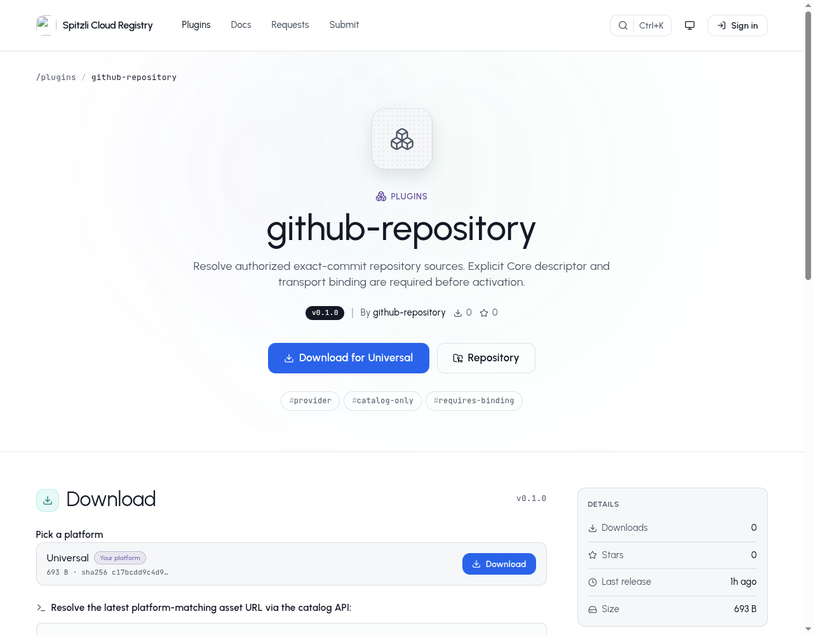

# GitHub Repository


Resolve an approved GitHub commit and obtain its normalized source archive for platform builds and exports.

## What you can do

Read-only commit resolution and source archive retrieval for one explicitly authorized repository at a time.

## Setup and access

Operator integration only. Requires a GitHub App, Core repository admission, an exact publisher-signed descriptor and matching release, manifest and image digest. Publishing the catalog entry does not bind this specialized runtime.

## Data and security

GitHub App key material stays in private runtime configuration. Short-lived repository leases and live Core authorization scope requests. Source archives are normalized and bounded; credentials never enter customer UI.

## Status and limits

Beta integration, with no standalone customer panel. OAuth onboarding, webhook handling, Actions provenance and check delivery remain pending. API JSON is capped at 2 MB; downloaded and expanded archives at 128 MiB each.

Catalog publication does not activate the plugin, enable public signup or grant
access to any customer resource. A new presentation release must use a new version;
previously signed releases and their assets stay immutable.

## Gallery

Actual public catalog v0.1.0, captured before this presentation release. Catalog-only; explicit runtime binding required, no customer UI.



## Catalog source

`.tabularium` is the complete catalog-refresh source. It retains the immutable
runtime image and full protocol/access contract of the currently released
`0.1.0` and adds the prepared presentation assets. Refresh it only from a
reviewed immutable source commit. This does not replace signed release assets
or activate the runtime.

## Technical reference

The retained implementation notes below include platform integration procedures.
Commands referring to Core, `tools/` or `apps/console` require the [platform source
checkout](https://github.com/spitzli/webdock); they are not standalone setup steps.

This standalone Rust workspace implements scoped GitHub commit resolution and source archives. It is not a Core dependency. Build it with `cargo build --manifest-path Cargo.toml --release --locked`; run the resulting `spitzli-github-repository` binary with one absolute private configuration file path. Shared protocol/runtime crates are build dependencies, while provider credentials and vendor behavior stay here.

The process requires a publisher-signed repository descriptor, its pinned public key, the Core lease issuer public key, current runtime generation, GitHub App ID and a private RSA key file. The descriptor must match the separately installed plugin manifest, version and image digest. Configuration uses these fields:

- `descriptor`, `publisherPublicKeyHex`, `issuerPublicKeyHex`, `generation`, `appId`, `appPrivateKey`.
- `listen`: `{ "kind": "unix", "path": "/private/plugin.sock" }`, or `mutualTls` with `address`, `certificate`, `privateKey`, `authority` paths.
- `core`: a private Unix `path`, or `mutualTls` with `origin`, `domain`, `certificate`, `privateKey`, `authority`.
- `corePeers`: exact `{ "kind": "unix", "uid": 123 }` or `{ "kind": "mutualTls", "certificateSha256": "..." }` pins.

Configuration and private keys must be regular, single-link, owned private files. Private sockets require a canonical directory owned by the process with mode 0700. Remote TLS always requires a client identity and explicit trust root. Every request verifies the separate repository lease signature and checks live Core admission before, during and after work. A valid signature alone is insufficient. Unknown public configuration fields are denied; the provider action configuration is currently `{}`.

The installed manifest must declare `repository.resolve` and `repository.archive` as read actions with the approved `plugin.http.read` capability. Existing project/customer grants and runtime credentials still apply. Installation/controller packaging for this separate protocol lane must use its signed descriptor and explicit runtime binding; this executable does not enroll itself or alter grants.

Octocrab supplies maintained GitHub App JWT signing and the typed installation-token request. Raw responses are validated so unknown permission keys cannot be discarded by a permissive response model. Every token request names exactly one repository and exact read permissions. API JSON is limited to 2 MB; source download and expanded archive limits are each 128 MiB. Redirects and ambient proxies are disabled. The one expected tarball redirect must bind the exact repository/commit on the codeload origin; codeload receives no installation credential. Signed download query strings are accepted but never logged. Archive normalization rejects links, special/sparse entries, traversal, duplicate names, multiple wrappers and trailing data. Executable bits survive; privileged bits do not.

Validation uses only local controlled HTTP fixtures, newly generated test RSA keys, signed leases, and a real standalone plugin subprocess over private RPC:

```sh
cargo test --manifest-path Cargo.toml --locked --features local-provider-test
cargo clippy --manifest-path Cargo.toml --all-targets --features local-provider-test -- -D warnings
```

`local-provider-test` is not a production build feature. It adds an explicit loopback-only mock origin; production builds accept only the fixed GitHub API/codeload origins. OAuth onboarding, webhook handling, Actions artifact provenance and check delivery remain pending. No production provider request was made during validation.
